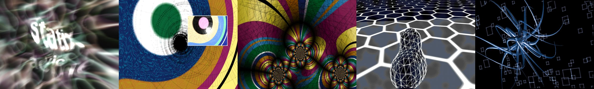
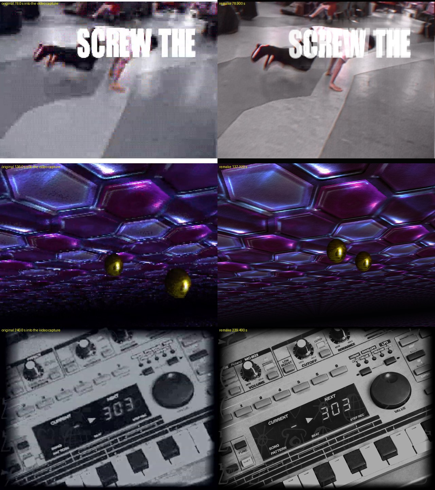

# 303 by Acme

*303* is a PC demo by Acme, released at the X'97 party in April 1997, where it won the demo competition. Code by
Statix, music and vocals by Vic, graphics and design by Aap. In the NFO they ask whether it is the first original
song demo. Vic's vocals were recorded as MPEG audio and spliced into the tracker module at run time. The demo also
plays video clips through its own codec, including Harlequin breakdancing. It was finished ten minutes before the
competition, four hours after the deadline. On the way four days of demo-making killed two motherboards, a video
capture card and a hard disk.

Links: [pouet.net](https://www.pouet.net/prod.php?which=44) · [demozoo](https://demozoo.org/productions/62/) · [scene.org download](https://files.scene.org/view/demos/groups/acme/demos/acme_303.zip)

## Watch

A 4K video of the remake is coming to YouTube.

## Versions in this folder

| folder | what it is |
|---|---|
| [`remake/`](remake/) | **The current remake.** Every effect ported from the decompiled executable: the original's algorithms, constants, timing and palette system, evaluated per pixel at any resolution. |
| [`remake-v1/`](remake-v1/) | The first version, rebuilt by eye from a video capture after the data files were decoded exactly. Kept to show the first step. |
| [`re/`](re/) | The reverse-engineering notes: every part as pseudo-C with all constants, plus the briefs the agents worked from and the comparison scripts. |
| [`original/`](original/) | Put the original files here (they are not in the repository). |
| [`docs/making-of.md`](docs/making-of.md) | How both versions were made. |
| [`docs/techniques.md`](docs/techniques.md) | What Acme achieved in 1997 and how: the video clips, the MPEG vocals and Statix's patch of the GUS driver. |

## Run it

Download the "303 remake" for Windows or Linux from [Releases](https://github.com/dvdstelt/demoscene/releases), unpack
it, run `fetch-originals.ps1` (Windows) or `./fetch-originals.sh` (Linux) in its folder to get the original files, and
start `acme303`. Or build it yourself:

1. Get the original files: `scripts/fetch-originals.sh 303` from the repository root (Windows:
   `powershell -ExecutionPolicy Bypass -File scripts\fetch-originals.ps1 303`), or copy them into `303/original/`.
2. Build: `cmake -S 303/remake -B 303/remake/build -G Ninja && cmake --build 303/remake/build`
   (needs SDL3 and libopenmpt; CMake downloads them if they are missing).
3. Run: `303/remake/build/acme303` (fullscreen; `--window` for a window).

[`remake/README.md`](remake/README.md) has all options, keys and build details per platform.

## How close is it?

*The original (left, from a video capture of it running on a Pentium MMX) and the remake (right, with the restored
video clip and the redrawn picture), at the same moments.*

The remake runs the original's routines, ported one by one and compared side by side with a capture of the
original running on a Pentium MMX. Two things cannot be exact:

- **Randomness.** Many choices come from `rand()`, and how far the sequence has advanced depends on the PC's frame
  rate, so every run of the original differed. The remake replays Watcom's `rand()` from a fixed seed, and scripts
  the outcome seen in the capture where it matters.
- **Frame-rate dependent feedback.** Trails and ghosting are applied per drawn frame in the original. The remake
  runs them at fixed rates measured from the capture.

The remake's README lists the remaining known differences.
