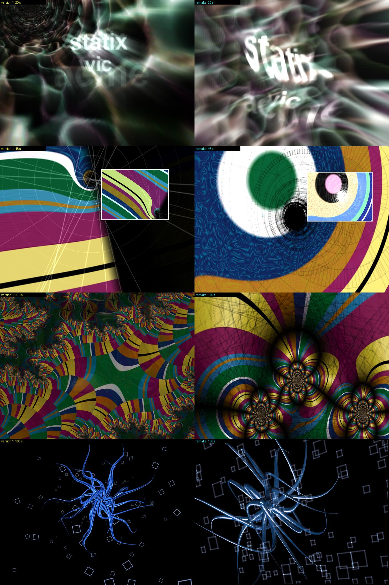

# Making of the 303 remake

The 303 remake was made in two steps. The first version was rebuilt from a video and looked like the demo. The
second was ported from the decompiled executable and runs the demo's own effects. Both were written by Claude Code
agents, directed by Dennis van der Stelt; [../../docs/how-it-was-made.md](../../docs/how-it-was-made.md) describes
the general way of working.

## The starting point

It started with a YouTube capture of 303 and a question: could this run on Windows and Linux with upgraded
graphics? The inputs were the original release (`303.EXE` and its data files) and a local copy of that capture,
960×720 at 30 fps, recorded on a Pentium MMX. The request was the same as the original, but much sharper: 256
colours at 320×200 should become true colour at any resolution.

## Version 1: from the video ([`remake-v1/`](../remake-v1/))

The data files were decoded exactly, from the file formats and the executable's loader code:

| file | what it turned out to be |
|---|---|
| `MUSTARD.PAK` | an archive of 45 files compressed with a variant of Mark Nelson's LZW15V: palettised textures (320×200 and 256×256 tiles, 6-bit palettes), fonts, three different mesh formats, fade tables (`*.fad`) and blend tables (`*.gst`) |
| `GARLIC.PAK` | a 30-channel PolyTracker module (PTM) |
| `KETCHUP.PAK` | an MPEG-1 layer II stream with Vic's vocals and drum loops. Statix's MIDAS hack loads it into sample slots 48–90 of the module. The remake decodes it with minimp3 and puts it back as 16-bit samples, then plays the rebuilt module with libopenmpt |
| `ALEX.LZW`, `HARL.LZW`, `VS.LZW`, `PARANOID.LZW` | video clips in a custom codec: 4×4 DCT blocks in zigzag order with a running DC, YIQ colour planes (PARANOID is luma only), decoded through the palette with 16-level dithering |

The executable is a Watcom C/C++ program for the DOS/4GW extender (LE format). `tools/le_load.py` loads it with its
fixups, `tools/re303.py` disassembles it with capstone, and `tools/lzw.py` and `tools/dumpvideo.cpp` unpack the
data. Those were enough for the formats.

The effects were rebuilt by eye from the capture, part by part: tunnels and warps, a radial blur, a ray-traced
hexagon corridor with metaballs, environment-mapped meshes, the lyric overlays and the video parts. The running
order was measured on the capture. The capture plays 0.126% slow and starts 1.4 s into the music, so the soundtrack
was aligned to it by cross-correlating onsets.

The result looked and sounded like 303. Dennis's verdict was that much of it didn't match the real effects, and
that the opening in particular was wrong. Version 1 drew it as a tunnel, but in the demo the names "statix" and
"vic" appear many times across the screen and then come together into big names. The video alone could not show
how the effects really worked. That needed the code.

## Version 2: from the executable ([`remake/`](../remake/))

*Version 1, rebuilt from the video (left), and the remake ported from the executable (right), at the same moments.*

### Decompiling

First the shared machinery was mapped, and every agent got it in a brief ([`re/BRIEF.md`](../re/BRIEF.md)):

- **Calling and effect conventions.** Watcom's register calling convention. An effect routine called with 0x17
  initialises, with 0x48 frees, and called with a buffer pointer renders one 320×200 frame into it.
- **The main script** at 0x30aa2, which runs the parts in order.
- **The asset loaders.**
- **The clock.** MIDAS calls a timer routine at each vertical retrace, about 70 times a second. It advances the
  music position `[0x9b844]` (2 × (order × 64 + row) − 2) and runs the registered callbacks.

Then agents decompiled one section each into a notes file:

| notes | parts |
|---|---|
| [notes-aap.md](../re/notes-aap.md) | Aap's stripe compositions, blobby |
| [notes-mid1.md](../re/notes-mid1.md) | the rings tunnel, the Julia-set flowers, the relief face, the face box |
| [notes-mid2.md](../re/notes-mid2.md) | typo, blobs, wire blobs |
| [notes-mid3.md](../re/notes-mid3.md) | spiral, Vic's photo, the tentacle star, plasma |
| [notes-late.md](../re/notes-late.md) (+ [part 3](../re/notes-late-part3.md), [part 4](../re/notes-late-part4.md)) | web, Harlequin, paranoid, face floor, dance, icons, outro |

For each routine an agent wrote down:

- what it draws;
- pseudo-C with every constant, and the tables it generates;
- the time base of every animated variable: per 70 Hz tick, per drawn frame, or from the music position;
- the exact differences from version 1, by file and line.

The opening, for example, turned out to be a sphere-mapped texture ghosted into its previous frame. The credits
picture is drawn through a grid that blends a rotating sine swirl with a rippling identity mapping. Because it
is added into the feedback buffer, the many small copies settle into the big names and saturate to white. No
amount of watching would have given those constants.

### Porting

The building blocks that several parts share were ported first, into `src/exefx.*`:

- the palette system (fades, flashes, negative strobes, brightness kicks);
- Watcom's `rand()`;
- the sphere-ray grid;
- the soft additive line stamps;
- the lyric renderer;
- the inverted thumbnail inset.

The opening, Aap's part and blobby were ported first, as reference ports. Then porting agents
([`re/PORT.md`](../re/PORT.md)) each took one scene file and replaced version 1's code with a port of the notes.
They checked every part with side-by-side sheets: capture on the left, remake on the right, at the same moments
(`re/compare.sh`).

Two ideas from that brief carry the timing:

- **Replaying callbacks.** State that the original advances in its 70 Hz callbacks is replayed from the start of
  the part on every frame. That is cheap, deterministic and exact after seeking.
- **Fixed-rate feedback.** State that the original advances per drawn frame (trails, ghosting) runs at a fixed
  rate measured from the capture.

In the capture the picture leads the sound by about 0.5 s at the start, shrinking to zero after about two minutes.
A measured table (`captureLead()`) lines the effects up with it.

### What "sharper" means here

The remake evaluates per pixel what the original computed on an 8×8-pixel grid, and keeps colours in floating
point instead of snapping them to 256 palette entries. Lines, contours and edges are anti-aliased. Video frames
are decoded in floating point and shown without the 16-level dithering. Fonts are signed distance fields. The
algorithms, constants, motion and timing are the original's.

### Reading the originals, not copying them

Before the repository went public, the source was checked for data copied from the originals. The lyric and song
tables, the credit layout, the web and icon tables, a jitter table and the marching-cubes case table had been
written into the code. Now `src/exe.*` loads `303.EXE` with its fixups, checks it by size and hash, and the parts
read those tables by address. Frames rendered before and after the change are identical.

## What is not exact

- **Randomness** depends on the frame rate of the PC the demo ran on. Fixed seeds are used, and where the capture
  shows a specific outcome that matters, such as a mode switch, a word position or a ball path, that outcome is
  scripted.
- **Frame-rate dependent feedback** runs at the rates measured from the capture (35–140 fps depending on the part).
- **Fade tables** snap to the nearest palette colour in the original. The remake blends in true colour and keeps
  the hue shifts only where they are visible.
- **The plasma section's camera roll**, and the look of its balls in places.
- **The web words.** The code colours them red and violet, but the capture shows blue and yellow. The remake
  follows the capture.

## Files

- [`re/`](../re/): the notes, the two agent briefs (`BRIEF.md` for decompiling, `PORT.md` for porting),
  `compare.sh` / `grab.sh` (comparison sheets; they need a video capture of the original in `$CAPTURE`),
  `pos.py` + `rows.txt` (music position ↔ time), `tables.py` (fitting a `.gst` blend table).
- [`remake/tools/`](../remake/tools/): the LE loader, the disassembly helper, the LZW decoder, the video frame
  dumper and the module row timer.
