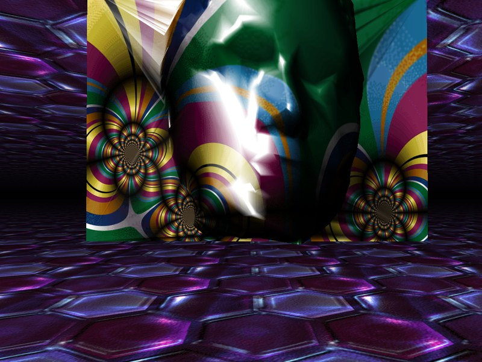
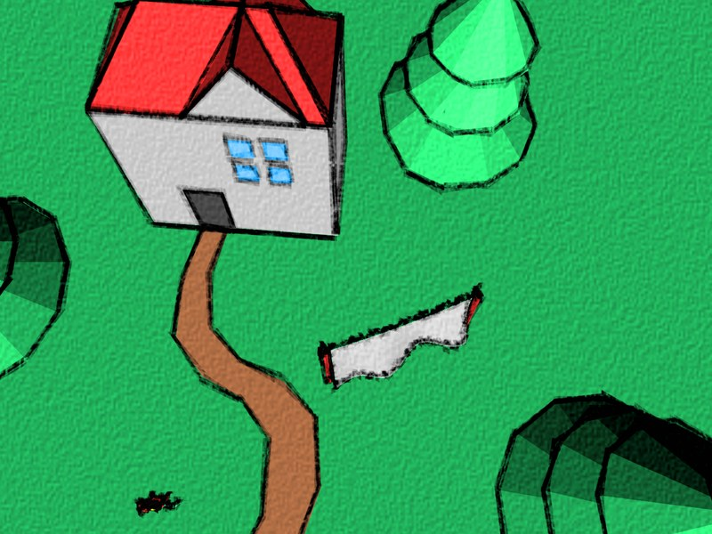
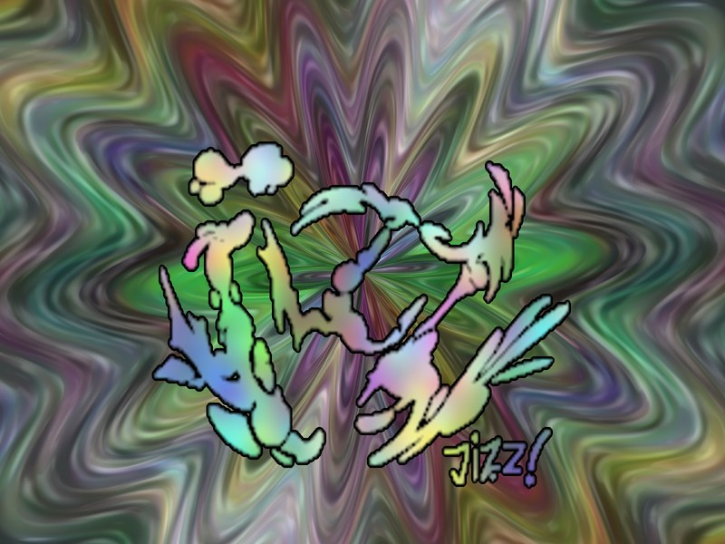

# demoscene remakes

High-resolution remakes of classic MS-DOS demoscene productions for Windows and Linux. Each remake was reverse
engineered from the original executable and plays the original's own effects, timing and music. It renders them at
any resolution in true colour instead of 320×200 in 256 colours (or, for JIZZ, 320×200 in hicolor).

| [303](303/) by Acme | [Paper](paper/) by Psychic Link | [JIZZ](jizz/) by The Black Lotus |
|---|---|---|
|  |  |  |

## The demos

| production | group | released | type | remake |
|---|---|---|---|---|
| [**303**](303/) | Acme | X'97, April 1997 | PC demo, winner of the X'97 demo competition | [remake](303/remake/), ported from the executable routine by routine; [first version](303/remake-v1/) rebuilt from a video |
| [**Paper**](paper/) | Psychic Link | Wired '96, November 1996 | 64k intro | [remake](paper/remake/), ported from the executable routine by routine and checked tick by tick in an emulator |
| [**JIZZ**](jizz/) | The Black Lotus | Wired '97, 1997 | 64k intro, winner of the PC 64k intro competition | [remake](jizz/remake/), ported from the executable routine by routine and checked against an emulator capture |

303 and Paper were coded by Statix, with music by Vic of Acme. JIZZ was coded by Jace, with music by Probe and a
vector engine by Nix.

## Watch

YouTube videos of the remakes (4K, 60 fps) are coming. Until then, build and run them yourself, as described below.

## Run a remake

The remakes need the original release files, which are not included here; they remain the property of their
authors. The fetch scripts download them from [scene.org](https://www.scene.org/) and check them.

**Windows**: download a remake from [Releases](https://github.com/dvdstelt/demoscene/releases), unpack it, and in that folder run

```
powershell -ExecutionPolicy Bypass -File fetch-originals.ps1
```

then start `acme303.exe`, `paper-remake.exe` or `jizz-remake.exe`.

**Linux** (or Windows with CMake and a compiler):

```
git clone https://github.com/dvdstelt/demoscene && cd demoscene
scripts/fetch-originals.sh
cmake -S paper/remake -B paper/remake/build -G Ninja && cmake --build paper/remake/build
paper/remake/build/paper-remake
```

Use `303/remake` (program `acme303`) for 303 and `jizz/remake` (program `jizz-remake`) for JIZZ. CMake needs SDL3
(and libopenmpt for 303). If they are not
installed, it downloads and builds them. Each remake's README lists the packages per platform and all options.

Keys: `Esc` quit, `Space` pause, `←/→` seek 5 s, `↑/↓` seek 30 s, `F`/`F11` fullscreen. Add `--window` to start in
a window.

## How they were made

The work was done with [Claude Code](https://claude.com/claude-code), Anthropic's coding agent, directed by Dennis
van der Stelt. He supplied the original files, compared the results with how he remembered the demos and pointed
out what was wrong. Claude Code did the reverse engineering and wrote the code. Many agents worked in parallel,
each on one part of a demo:

1. **Watch.** The first 303 remake was rebuilt by eye from a video capture, after decoding the data files exactly:
   LZW archives, a custom video codec, and a tracker module with MP2 vocals.
2. **Decompile.** The executables were taken apart: 303 is a Watcom C program for DOS/4GW, Paper is
   hand-written assembly compressed with PKLITE and running under PMODE, and JIZZ is hand-written assembly for the
   DOS32 extender that generates its textures and most of its music samples at start-up. Agents rewrote every effect routine as
   pseudo-C with all its constants, in notes such as [paper/re/notes-sketch.md](paper/re/notes-sketch.md).
3. **Emulate.** Paper and JIZZ run headless in a small emulator built on unicorn, with fake VGA or VESA, timer
   and Gravis UltraSound hardware. That gives the exact screen, palette and sound-card state for every timer tick,
   which was used to check every routine.
4. **Port and compare.** Each part was rewritten for the GPU and compared frame by frame with the original.

[docs/how-it-was-made.md](docs/how-it-was-made.md) has the whole story. Each demo also has a making-of:
[303](303/docs/making-of.md), [Paper](paper/docs/making-of.md), [JIZZ](jizz/docs/making-of.md). The tools are described in
[docs/reverse-engineering.md](docs/reverse-engineering.md).

## Repository layout

```
303/  paper/  jizz/   one folder per production
  README.md           about the original, versions, how to run
  original/           put the original files here (not in Git)
  remake/             the current remake (CMake project)
  remake-v1/          303 only: the first version, rebuilt from a video
  re/                 reverse-engineering notes and scripts
  docs/               making-of and images
docs/                 how it was made, tools, rendering the videos
scripts/              fetch the originals, package releases, render videos
AGENTS.md             instructions for AI coding agents working on this repository
```

## Credits and license

*303* is by Acme: code by Statix, music and vocals by Vic, graphics and design by Aap. *Paper* is by Psychic Link:
code, graphics and design by Statix, music by Vic of Acme. *JIZZ* is by The Black Lotus: code, design and graphics
by Jace, music by Probe, vector engine and metaballs by Nix, VESA code by Ballein, the "jizz" logo by Sjaak of
Trepaan. The originals and everything in them remain theirs. This
project is a non-commercial tribute, not affiliated with them. See [NOTICE.md](NOTICE.md).

The code and documentation in this repository are licensed under the
[PolyForm Noncommercial License 1.0.0](LICENSE.md): use, change and share them freely for any non-commercial
purpose, but do not make money from them.
