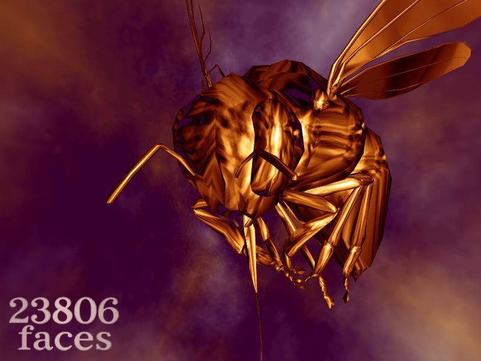
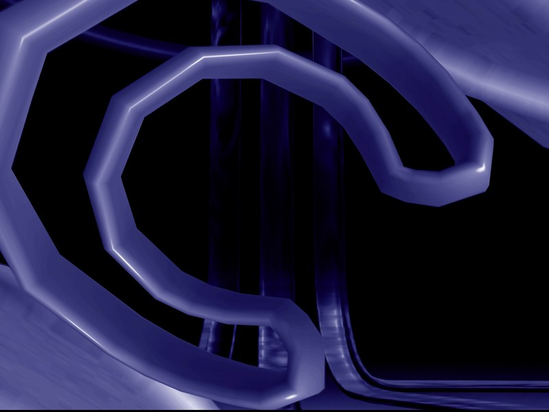
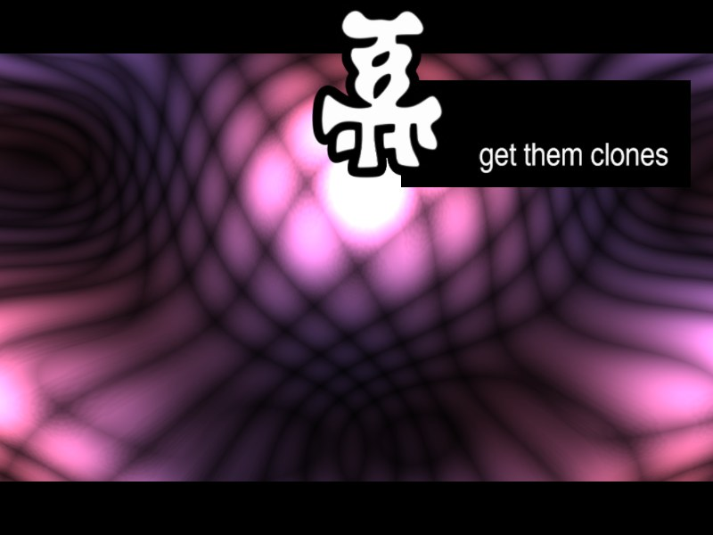

# demoscene remakes

High-resolution remakes of classic MS-DOS demoscene productions for Windows and Linux. Each remake was reverse
engineered from the original executable and plays the original's own effects, timing and music. It renders them at
any resolution in true colour instead of 320×200 in 256 colours (or, for JIZZ, 320×200 in hicolor, and for clone
meets clone, 320×200 in true colour).

| [303](303/) by Acme | [Paper](paper/) by Psychic Link | [JIZZ](jizz/) by The Black Lotus |
|---|---|---|
|  |  |  |
| **[STARS](stars/) by NoooN** | **[DOPE](dope/) by Complex** | **[clone meets clone](clone/) by Acme and Fudge** |
|  |  |  |

## The demos

| production | group | released | type | remake |
|---|---|---|---|---|
| [**303**](303/) | Acme | X'97, April 1997 | PC demo, winner of the X'97 demo competition | [remake](303/remake/), ported from the executable routine by routine; [first version](303/remake-v1/) rebuilt from a video |
| [**Paper**](paper/) | Psychic Link | Wired '96, November 1996 | 64k intro | [remake](paper/remake/), ported from the executable routine by routine and checked tick by tick in an emulator, with a redrawn sketch, text and inked logo |
| [**JIZZ**](jizz/) | The Black Lotus | Wired '97, 1997 | 64k intro, winner of the PC 64k intro competition | [remake](jizz/remake/), ported from the executable routine by routine and checked against an emulator capture, with a redrawn logo and end picture |
| [**STARS**](stars/) | NoooN | Assembly '95, August 1995 | PC demo, winner of the PC demo competition | [remake](stars/remake/), ported from the executable routine by routine and checked against an emulator capture, with redrawn pictures |
| [**DOPE**](dope/) | Complex | The Gathering '95, April 1995 | PC demo, winner of the PC demo competition | [remake](dope/remake/), ported from the executable routine by routine and checked against an emulator capture, with redrawn pictures |
| [**clone meets clone**](clone/) | Acme and Fudge | Takeover '98, May 1998 | 64k intro, winner of the PC 64k intro competition | [remake](clone/remake/), ported from the executable routine by routine and checked against an emulator capture, with redrawn pictures |

303 and Paper were coded by Statix, with music by Vic of Acme. JIZZ was coded by Jace, with music by Probe and a
vector engine by Nix. STARS was coded by KARL and BARTi, with pictures by RA and music by Groo. DOPE was coded by
jmagic, with graphics and music by jugi. clone meets clone was coded by Echo, with graphics by Aap (who also drew
303's) and music by Simon.

All six remakes show high-resolution redraws of the originals' hand-drawn pictures: AI redraws made from the original
pictures and faithful to them (303 also shows its video clips restored with a video model). Start them with
`--original-art` to see the original pixels instead.

## Watch

YouTube videos of the remakes (4K, 60 fps) are coming. Until then, build and run them yourself, as described below.

## Run a remake

The remakes need the original release files, which are not included here; they remain the property of their
authors. The fetch scripts download them from [scene.org](https://www.scene.org/) and check them.

**Download**: [Releases](https://github.com/dvdstelt/demoscene/releases) has each remake for Windows (a zip) and for
Linux (a tar.gz, for 64-bit Linux with glibc 2.34 or newer). Unpack it, and in that folder run

```
powershell -ExecutionPolicy Bypass -File fetch-originals.ps1
```

on Windows, or `./fetch-originals.sh` on Linux. Then start `acme303`, `paper-remake`, `jizz-remake`, `stars-remake`,
`dope-remake` or `clone-remake` (`.exe` on Windows).

**Build it yourself** (Linux, or Windows with CMake and a compiler):

```
git clone https://github.com/dvdstelt/demoscene && cd demoscene
scripts/fetch-originals.sh
cmake -S paper/remake -B paper/remake/build -G Ninja && cmake --build paper/remake/build
paper/remake/build/paper-remake
```

Use `303/remake` (program `acme303`) for 303, `jizz/remake` (program `jizz-remake`) for JIZZ, `stars/remake`
(program `stars-remake`) for STARS, `dope/remake` (program `dope-remake`) for DOPE and `clone/remake` (program
`clone-remake`) for clone meets clone. CMake needs SDL3 (and libopenmpt for 303). If they are not installed, it
downloads and builds them. Each remake's README lists the packages per platform and all options.

Keys: `Esc` quit, `Space` pause, `←/→` seek 5 s, `↑/↓` seek 30 s, `F`/`F11` fullscreen. Add `--window` to start in
a window.

## How they were made

The work was done with [Claude Code](https://claude.com/claude-code), Anthropic's coding agent, directed by me,
Dennis van der Stelt. I supplied the original files, compared the results with how I remembered the demos and
pointed out what was wrong. Claude Code did the reverse engineering and wrote the code. Many agents worked in
parallel, each on one part of a demo:

1. **Watch.** The first 303 remake was rebuilt by eye from a video capture, after decoding the data files exactly:
   LZW archives, a custom video codec, and a tracker module with MP2 vocals.
2. **Decompile.** The executables were taken apart: 303 is a Watcom C program for DOS/4GW, Paper is
   hand-written assembly compressed with PKLITE and running under PMODE, and JIZZ is hand-written assembly for the
   DOS32 extender that generates its textures and most of its music samples at start-up. STARS is a PMODE program
   behind an encrypting loader and PKLITE, with its data in 58 DIET-compressed files appended to the executable.
   DOPE is a chain of executables in one file, packed with ProPack: a PMODE loader with the music player, then
   seven real-mode parts. clone meets clone is a Watcom C program packed behind a small loader under PMODE/W that
   synthesises most of its music samples at start-up. Agents rewrote every effect routine as pseudo-C with all its
   constants, in notes such as [paper/re/notes-sketch.md](paper/re/notes-sketch.md).
3. **Emulate.** Paper, JIZZ, STARS, DOPE and clone meets clone run headless in a small emulator built on unicorn,
   with fake VGA or VESA, timer and Gravis UltraSound hardware. That gives the exact screen, palette and sound-card
   state for every timer tick or displayed frame, which was used to check every routine.
4. **Port and compare.** Each part was rewritten for the GPU and compared frame by frame with the original.
5. **Redraw.** For all six, the hand-drawn pictures were redrawn at high resolution with ChatGPT's image
   generation from the original pixels (one that ChatGPT refused with Qwen-Image-Edit on Comfy Cloud), then fitted
   onto the originals and measured against them; 303's video clips were restored with SeedVR2.
   [docs/redrawing-pictures.md](docs/redrawing-pictures.md) is the recipe.

[docs/how-it-was-made.md](docs/how-it-was-made.md) has the whole story. Each demo also has a making-of:
[303](303/docs/making-of.md), [Paper](paper/docs/making-of.md), [JIZZ](jizz/docs/making-of.md),
[STARS](stars/docs/making-of.md), [DOPE](dope/docs/making-of.md), [clone meets clone](clone/docs/making-of.md).
The tools are described in [docs/reverse-engineering.md](docs/reverse-engineering.md).

What the original coders did in their time, and how, is on a page per demo: [303](303/docs/techniques.md),
[Paper](paper/docs/techniques.md), [JIZZ](jizz/docs/techniques.md), [STARS](stars/docs/techniques.md),
[DOPE](dope/docs/techniques.md), [clone meets clone](clone/docs/techniques.md). It comes from the decompiled code
and the scene's own record of the time.

## Repository layout

```
303/  paper/  jizz/  stars/  dope/  clone/
                      one folder per production
  README.md           about the original, versions, how to run
  original/           put the original files here (not in Git)
  remake/             the current remake (CMake project)
  remake/art/         the redrawn pictures
  remake-v1/          303 only: the first version, rebuilt from a video
  re/                 reverse-engineering notes and scripts
  docs/               making-of, the original's techniques, images
docs/                 how it was made, tools, redrawing pictures, rendering the videos
scripts/              fetch the originals, package releases, render videos
AGENTS.md             instructions for AI coding agents working on this repository
```

## Credits and license

*303* is by Acme: code by Statix, music and vocals by Vic, graphics and design by Aap. *Paper* is by Psychic Link:
code, graphics and design by Statix, music by Vic of Acme. *JIZZ* is by The Black Lotus: code, design and graphics
by Jace, music by Probe, vector engine and metaballs by Nix, VESA code by Ballein, the "jizz" logo by Sjaak of
Trepaan. *STARS: Wonders of the World* is by NoooN: music by Groo, 3D motion and vertices by BARTi, system and
special effects by KARL, script and pixels by RA, sound code by LCA. *DOPE* is by Complex: code by jmagic, graphics
and music by jugi, the routine boxes sketched by jugi and pixelled by Reward, the Media Labs logo by Reward, the
music replay routine by Phantom of Sonic PC (GUS part adapted by jmagic), 3D objects by jugi and M. Hakulinen.
*clone meets clone* is by Acme and Fudge: design by Aap and Echo, effects by Echo, music by Simon, graphics by Aap,
texture mapper and grid filler by Craft, the original radial blur by Dune, graphics help by Assa, the VESA library by
Submissive, MXMPlay by Pascal (Niklas Beisert), PMODE/W by Daredevil and Tran. The originals and everything in them
remain theirs; the redrawn pictures are derived from their artists' work and stay under the same non-commercial
terms. This project is a non-commercial tribute, not affiliated with them. See
[NOTICE.md](NOTICE.md).

The code and documentation in this repository are licensed under the
[PolyForm Noncommercial License 1.0.0](LICENSE.md): use, change and share them freely for any non-commercial
purpose, but do not make money from them.
