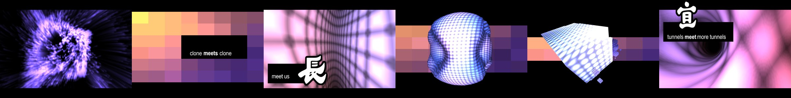
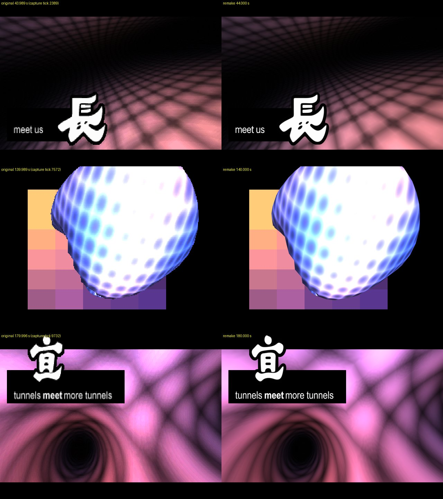

# clone meets clone by Acme and Fudge

*clone meets clone* is a 64k intro by the Dutch group Acme and the Danish group Fudge that won the PC 64k intro
competition at Takeover '98 in Eindhoven (15–17 May 1998), with 395 points ahead of Analogue's *Mindflow* (257).
Its INFO file gives the main credits to Aap, Echo and Simon: design by Aap and Echo, effects by Echo, music by
Simon, graphics by Aap. The additional credits name Assa (graphics help and network solutions), Craft (texture
mapper, grid filler, "stuff"), Daredevil and Tran (PMODE/W), Dune (the original radial blur), Pascal (MXMPlay),
Submissive (the VESA library) and Unreal ("segment bss"). It asks for a 133 MHz Pentium or an AMD K6 and a Gravis
UltraSound with 1 MB of memory, and draws at 320x200 in a 32-bit or 15-bit VESA mode: true colour, not 256 colours.

`CLONE.EXE` is 63,994 bytes: Daredevil and Tran's PMODE/W extender, a small loader, and a packed program that
unpacks to 165 KB. At start-up it builds the rest: 20 of the 21 samples of Simon's 18-channel module (about 1 MB
of drums and tones computed from sine formulas and uploaded to the GUS), the textures and the 3D objects.

The intro opens with a violet swarm of glowing dots tracing a slowly turning curve with long trails, later torn
into streaks by a pulsing radial blur, until the title "clone **meets** clone" fades in on black. Then a mosaic of
orange, pink and violet squares holds the title; the camera glides through a flat tube of crossing dark grid lines
over pink light ("meet us", with a brush-drawn glyph); a lumpy blob covered in blue spots flies in face by face in
front of a band of coloured tiles; a ball of blinking blue dots throws radial streaks; three metaballs, built from
textured cubes on a voxel grid, turn in front of the tiles; a warped, rotating zoom of the grid reverses its turn
three times ("get them clones"); a blob with travelling bumps morphs beside a block of tiles; a blue cloud of soft
dots blows up and drifts ("connect the dots"); the camera floats where three tunnels cross ("tunnels **meet** more
tunnels"); a tall column of slabs turns while the light pulses; and the swarm returns in a storm of streaks, flashes
white and gives way to the credits ".aap .echo .simon". Each of the four captions comes with a glyph that looks
like a kanji. It lasts 3 minutes 37 seconds.

Echo later converted it to Win32 (April 2001, with the two other Clone intros of 1998, *Kill the Clone* and *Alien
Sex Clone*); this remake is of the MS-DOS original.

Links: [pouet.net](https://www.pouet.net/prod.php?which=915) · [demozoo](https://demozoo.org/productions/41197/) ·
[Takeover 1998 results](https://demozoo.org/parties/995/#competition_3923) ·
[scene.org download](https://files.scene.org/view/demos/groups/fudge/acme_cln.zip)

## Watch

A 4K video of the remake is coming to YouTube.

## In this folder

| folder | what it is |
|---|---|
| [`remake/`](remake/) | The remake: every routine ported from the decompiled executable, checked against the original running in an emulator, with high-resolution redraws of Aap's pictures. |
| [`re/`](re/) | The reverse-engineering notes for every routine, the unpacker, the emulator harness and the scripts the agents used to check their models. |
| [`original/`](original/) | Put `CLONE.EXE` here (it is not in the repository). |
| [`docs/making-of.md`](docs/making-of.md) | How the remake was made, and the decisions taken on the way. |
| [`docs/techniques.md`](docs/techniques.md) | What Acme and Fudge achieved in 1998 and how: the packed 64k, the synthesised soundtrack, the log-encoded textures, Craft's fillers and Dune's blur. |

## Run it

Download the "clone meets clone remake" for Windows or Linux from [Releases](https://github.com/dvdstelt/demoscene/releases), unpack it and start `clone-remake`: the download includes the original release. Or build it yourself; the original release is in [`original/`](original/):

1. Build: `cmake -S clone/remake -B clone/remake/build -G Ninja && cmake --build clone/remake/build`. It needs SDL3,
   and CMake downloads it if it is missing.
2. Run: `clone/remake/build/clone-remake`. It starts fullscreen; add `--window` for a window, and `--original-art`
   to see the original pixels instead of the redrawn pictures.

The remake reads everything from `CLONE.EXE`: it unpacks the program as its loader does, builds the module and its
synthesised samples as the intro does and plays them with a port of its MXMPlay on a model of the GUS, and reads
the pictures, palettes, texture formulas' constants, tables and the parts' parameters by address. Nothing from the
intro is copied into the source; the redrawn pictures in [`remake/art/`](remake/art/) are made from the originals and
say so. [`remake/README.md`](remake/README.md) lists the options and the build details per platform.

## How close is it?

*The original (left, captured in the emulator) and the remake (right, with the redrawn pictures), at the same
moments.*

The remake runs the original's routines, ported one by one from the decompiled executable and compared with a capture
of the original running in an emulator at 150 million instructions per second, about the speed of the Pentium the
intro asks for. The music player's sound-card writes match the capture exactly, and every part starts at the music
position the original's sync table gives it.

The intro has no frame-rate limit: it draws as fast as the CPU allows and moves everything by the time that passed
since the last frame, so the remake evaluates that motion continuously and is smooth at any frame rate. The
particle parts change with the frame rate (the number of dots born per frame, the trails), so the remake steps them
at the capture's own frame times, with the original's random numbers: their dots are the capture's. Where the
capture's frame timing shifts a camera or a turn by a few milliseconds, the remake keeps the capture's.

Craft's grid filler and texture mapper are evaluated per pixel with filtered textures, the 3D parts with
anti-aliased edges and a depth buffer, the particles as smooth sprites and Dune's radial blur in the original's own
order. The pictures are AI redraws of Aap's captions, glyphs, title and credits, fitted onto the originals word by
word; `--original-art` shows the original pixels. [`remake/README.md`](remake/README.md) lists the remaining known
differences.
