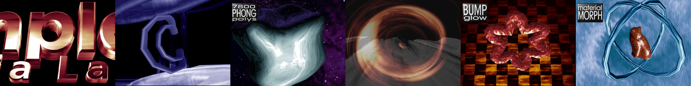
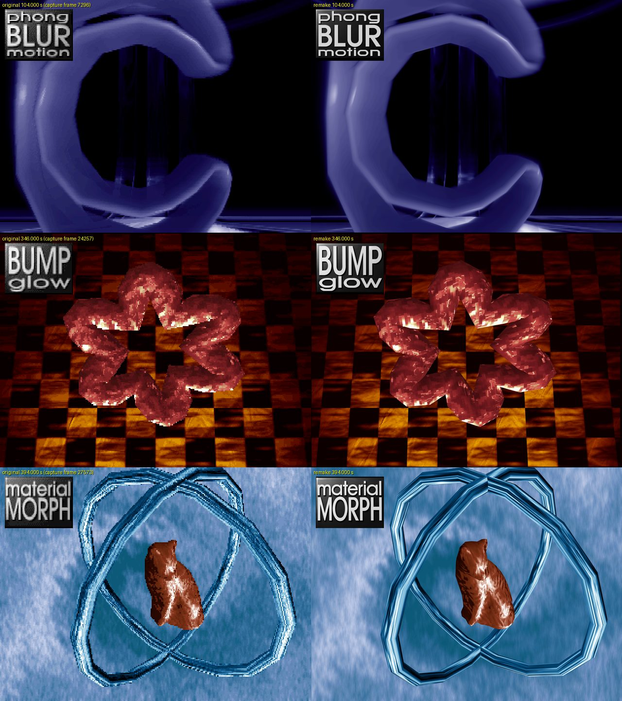

# DOPE by Complex

*DOPE* is a demo by the Finnish group Complex that won the PC demo competition at The Gathering '95 in Norway
(released 15 April 1995). DOPE.TXT credits the code to jmagic, the graphics and the music to jugi, the music replay
routine to Phantom of Sonic PC ("gus unit raped by jmagic"), the routine boxes to jugi (sketch) and Reward (pixels),
and the Media Labs logo to Reward. The 3D objects are by jugi (the credits part, the environment map) and M.
Hakulinen (the 7800 polys, world domination); the cat "found from some cdrom". The text also says it is "a bit"
unfinished: the end scroll is missing for lack of time. It needs a Gravis UltraSound with 512 KB for the music.

`DOPE.EXE` is a PMODE loader that keeps a 28-channel ProTracker module playing on the GUS while a chain loader runs
seven real-mode VGA parts one after the other. Each part counts the vertical retrace from its own start and never
looks at the music.

The demo opens with the chrome "Complex Media Labs" logo scrolling past while its colours turn from violet to
orange. Then two blue discs turn behind the credits ("jmagic code", "jugi music", "jugi graphics", "dope"), the
Complex "C" appears on its stand between them, and the camera flies around it with motion-blur trails ("phong BLUR
motion") until the picture fades to white. A lumpy Phong-shaded object tumbles towards the camera over a violet
nebula ("7800 PHONG polys"); orange fire spirals swirl over the nebula ("FIRE clouds") and over a grey fractal
landscape ("FRACTAL scape"); a gold env-mapped star-shaped torus flies over a marble chequerboard ("ENV mapping"),
then the same torus red with a pulsing bump-mapped glow ("BUMP glow"); a cat turns inside two blue rings whose
shadows fall on its fur ("SHADOW volume"), its fur turns to metal ("material MORPH", "METAL shading"); an
eight-armed tentacle object lit by five moving lights comes down over a desert horizon ("multiple LIGHT sources",
"1995 WORLD domination"); and "dope" stands above the horizon until the screen fades to black. It lasts about 7
minutes 40 seconds.

Links: [pouet.net](https://www.pouet.net/prod.php?which=37) · [demozoo](https://demozoo.org/productions/57/) ·
[The Gathering 1995 results](https://demozoo.org/parties/41/#competition_157) ·
[scene.org download](https://files.scene.org/view/demos/groups/complex/clx_dope.zip)

## Watch

A 4K video of the remake is coming to YouTube.

## In this folder

| folder | what it is |
|---|---|
| [`remake/`](remake/) | The remake: every routine ported from the decompiled executable, checked against the original running in an emulator, with high-resolution redraws of the hand-drawn pictures. |
| [`re/`](re/) | The reverse-engineering notes for every routine, the unpacker, the emulator harness and the scripts the agents used to check their models. |
| [`original/`](original/) | Put `DOPE.EXE` and `DOPE.MOD` here (they are not in the repository). |
| [`docs/making-of.md`](docs/making-of.md) | How the remake was made, and the decisions taken on the way. |
| [`docs/techniques.md`](docs/techniques.md) | What Complex achieved in 1995 and how, and what the grand effect labels really do. |

## Run it

Download the "DOPE remake" for Windows or Linux from [Releases](https://github.com/dvdstelt/demoscene/releases),
unpack it, run `fetch-originals.ps1` (Windows) or `./fetch-originals.sh` (Linux) in its folder to get the original
files, and start `dope-remake`. Or build it yourself:

1. Get the original: `scripts/fetch-originals.sh dope` from the repository root (Windows:
   `powershell -ExecutionPolicy Bypass -File scripts\fetch-originals.ps1 dope`), or download
   [`clx_dope.zip`](https://files.scene.org/view/demos/groups/complex/clx_dope.zip) from scene.org and unpack
   `DOPE.EXE` and `DOPE.MOD` into `dope/original/`.
2. Build: `cmake -S dope/remake -B dope/remake/build -G Ninja && cmake --build dope/remake/build`. It needs SDL3,
   and CMake downloads it if it is missing.
3. Run: `dope/remake/build/dope-remake`. It starts fullscreen; add `--window` for a window, and `--original-art` to
   see the original pixels instead of the redrawn pictures.

The remake reads everything from `DOPE.EXE` and `DOPE.MOD`: it unpacks the seven parts as their packer does, and
reads the pictures, palettes, meshes, tables and the parts' scripts from them by address; the music is the module
played by a port of the loader's player on a model of the GUS. Nothing from the demo is copied into the source; the
redrawn pictures in [`remake/art/`](remake/art/) are made from the originals and say so.
[`remake/README.md`](remake/README.md) lists the options and the build details per platform.

## How close is it?

*The original (left, captured in the emulator) and the remake (right, with the redrawn pictures), at the same
moments.*

The remake runs the original's routines, ported one by one from the decompiled executable and compared with a
capture of the original running in an emulator at the speed of a fast Pentium. The music player's sound-card writes
match the capture exactly. Each part starts where the capture starts it and counts the vertical retrace from there,
as the original does; the remake evaluates that motion continuously, so it is smooth at any frame rate, and shows
each part's state at the retrace the capture shows it. Three fades that the emulator ran four times too fast take
one retrace per step, as on a real VGA, so the last two parts start up to a second later against the music than in
the capture.

The 3D parts are drawn in float with anti-aliased edges, filtered maps and a depth buffer, with the original's
quirks kept: the flattened projection, the "C" sorted between the discs as the original sorts it, the bump maps'
patchy texels, and the faces that the original's 16-bit back-face test drops in p2's close-ups. p2's motion blur,
p4's fire and p6's ring shadows run on true colour instead of palette indices. The pictures are AI redraws of the
originals at about 1450x1090 for a screen, fitted onto them; `--original-art` shows the original pixels.
[`remake/README.md`](remake/README.md) lists the remaining known differences.
