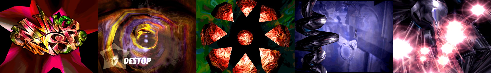
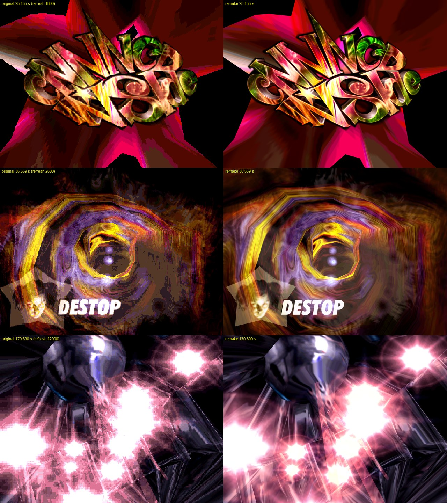

# Inside by CNCD

*Inside* is a PC demo by the Finnish group CNCD that won the PC demo competition at The Gathering 1996 in Hamar,
Norway (2–6 April 1996), with 173 points, far ahead of Coma's *The Control* and Melon Dezign and Scoop's *Ninja II*
(69 each). Its README credits the code to Wili, Jouni and Juliet, "graphics and all" to Destop, the music to Yolk and
Legend, additional graphics to Santtu, the DSMI sound system to Otto Chrons (Virtual Visions) and PMODE/W to Thomas
Pytel. It says the group's 3D engine, SurRender, "was used quite heavily", that the demo was first meant for
Assembly '95, and that it wants a fast Pentium and 5.5 MB of free memory. It draws at 320×200 in 256 colours (VGA
mode 13h) and plays the tune "eyegabo0om" through DSMI on any of its sound cards; the README dates it 3 April 1996.

`INSIDE.EXE` is 113,134 bytes: PMODE/W with the demo's Watcom C program in PMODE/W's own compressed format. The
pictures, textures, palettes, shade tables and 3D objects are in `INSIDE.DAT` (1.3 MB, one compressed block of 93
files), the music in `EYE.AMF`, DSMI's module format, and the sound drivers in DSMI's `.DSD` files.

The demo runs on the screen refresh: its timer interrupt fires four times per frame of the monitor, and every
effect, flash and fade is counted in refreshes. It opens with a picture of a woman and a tube of glue revealed by
drifting drops of light. Then come the twisted title over the inside of a turning, spiked red sphere; the credits,
a flight through a twisting painted tunnel past a spiked ball, with the names and small portraits of the group;
photographs of people on warping colourful backgrounds and in a turning room; a tunnel with a spinning, morphing
flower in front of the camera; a flight over a landscape with ships, a sun and lens flares; an underwater picture
that ripples behind a turning metal spiral and glass fish; more photographs; a picture twisted in a whirl; and a
chrome temple with glowing pipes and flares that fades to black. It lasts 3 minutes 6 seconds.

Links: [pouet.net](https://www.pouet.net/prod.php?which=74) · [demozoo](https://demozoo.org/productions/18030/) ·
[The Gathering 1996 results](https://demozoo.org/parties/42/#competition_1046) ·
[scene.org download](https://files.scene.org/view/parties/1996/gathering96/demo/inside.zip)

## Watch

A 4K video of the remake is coming to YouTube.

## In this folder

| folder | what it is |
|---|---|
| [`remake/`](remake/) | The remake: every routine ported from the decompiled executable, checked against the original running in an emulator. [`remake/art/`](remake/art/) holds the redrawn pictures. |
| [`re/`](re/) | The reverse-engineering notes for every routine, the unpackers, the emulator harness and the scripts the agents used to check their models. |
| [`original/`](original/) | Put `INSIDE.EXE`, `INSIDE.DAT`, `EYE.AMF` and `SDIGUS.DSD` here (they are not in the repository). |
| [`docs/making-of.md`](docs/making-of.md) | How the remake was made, and the decisions taken on the way. |
| [`docs/techniques.md`](docs/techniques.md) | What CNCD achieved in 1996 and how. |

## Run it

Download the "Inside remake" for Windows or Linux from [Releases](https://github.com/dvdstelt/demoscene/releases),
unpack it, run `fetch-originals.ps1` (Windows) or `./fetch-originals.sh` (Linux) in its folder to get the original
files, and start `inside-remake`. Or build it yourself:

1. Get the original: `scripts/fetch-originals.sh inside` from the repository root (Windows:
   `powershell -ExecutionPolicy Bypass -File scripts\fetch-originals.ps1 inside`), or download
   [`inside.zip`](https://files.scene.org/view/parties/1996/gathering96/demo/inside.zip) from scene.org, unpack
   the two zips inside it, and put `INSIDE.EXE`, `INSIDE.DAT`, `EYE.AMF` and `SDIGUS.DSD` into `inside/original/`.
2. Build: `cmake -S inside/remake -B inside/remake/build -G Ninja && cmake --build inside/remake/build`. It needs
   SDL3, and CMake downloads it if it is missing.
3. Run: `inside/remake/build/inside-remake`. It starts fullscreen; add `--window` for a window.

The remake reads everything from the original files: it unpacks `INSIDE.EXE` as PMODE/W does and `INSIDE.DAT` as
the demo does, reads the pictures, palettes, shade tables, objects and the parts' parameters by name and address,
and plays `EYE.AMF` with a port of DSMI's player on a model of the GUS. Nothing from the demo is copied into the
source. The hand-drawn title and the five names in the credits are shown as high-resolution redraws from
`remake/art/`; add `--original-art` to see the original pixels. The photos are always the original's.
[`remake/README.md`](remake/README.md) lists the options and the build details per platform.

## How close is it?

*The original (left, captured in the emulator) and the remake (right), at the same moments.*

The remake runs the original's routines, ported one by one from the decompiled executable and compared with a
capture of the original running in an emulator, one frame per screen refresh. The music player reproduces the
original's sound-card register writes exactly, and drawn in the original's way (`INSIDE_ENGINE=original`) the 3D
parts match the capture's pixels almost everywhere.

Inside counts everything in screen refreshes, and the remake follows that clock at any frame rate. It starts each
part and event on the music row that triggers it, where the original waits for its next frame, so the remake can
run up to a refresh ahead of the capture. Two parts, the intro's drops of light and the underwater scene, step their
simulation once per drawn frame; the remake replays the frames of the capture there.
[`remake/README.md`](remake/README.md) lists the remaining known differences.
