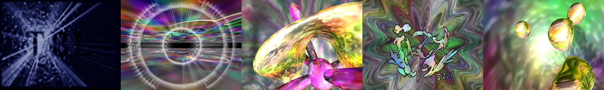
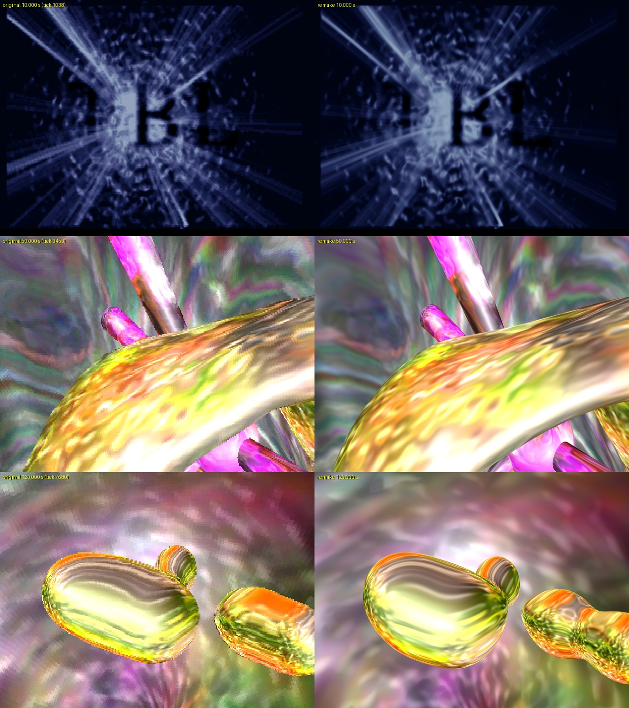

# JIZZ by The Black Lotus

*JIZZ* is a 64k intro by The Black Lotus that won the PC 64k intro competition at Wired '97. Code, design and
graphics are by Jace, the music is by Probe, the vector engine and the metaballs by Nix, the VESA code by Ballein,
and the "jizz" logo by Sjaak of Trepaan. Everything fits in one 63,960-byte DOS executable, which runs in 320x200
hicolor (65,536 colours) through VESA 2.0 and plays its music on a Gravis UltraSound.

The intro opens with "TBL" behind a burst of light rays. Then come twisted ribbons over cloud planes and a mirror
plane with rings, a textured tunnel, a yellow tube with pink spikes, Sjaak's logo over a star-shaped warp, a spiky
flower over clouds, a radial zoom, field lines between moving poles, and gold metaballs, before "~JIZZ~ TBL'97".

Jace's DOC says it was made in three weeks of "freaking like hell", and that Probe "managed to put 950Kb of music
into 20K". The code shows how: the textures are generated at start-up by a small byte-code interpreter from 16
scripts, and most of the music's samples are synthesised by the intro itself. The DOC also
mentions "a way to get the intro writing all the gfx and music to disk": that is `JIZZ /pandora` (the textures as
TGA files) and `JIZZ /mp4` (the music as an XM-like module).

Links: [pouet.net](https://www.pouet.net/prod.php?which=2) · [demozoo](https://demozoo.org/productions/12/) · [scene.org download](https://files.scene.org/view/demos/groups/tbl/pc/jizz.zip)

## Watch

A 4K video of the remake is coming to YouTube.

## In this folder

| folder | what it is |
|---|---|
| [`remake/`](remake/) | The remake: every routine ported from the decompiled executable, checked against the original running in an emulator. |
| [`re/`](re/) | The reverse-engineering notes for every routine, the unpacker, the emulator harness and the scripts the agents used to check their models. |
| [`original/`](original/) | Put `JIZZ.EXE` here (it is not in the repository). |
| [`docs/making-of.md`](docs/making-of.md) | How the remake was made. |

## Run it

1. Get the original: `scripts/fetch-originals.sh jizz` from the repository root (Windows:
   `powershell -ExecutionPolicy Bypass -File scripts\fetch-originals.ps1 jizz`), or copy `JIZZ.EXE` into `jizz/original/`.
2. Build: `cmake -S jizz/remake -B jizz/remake/build -G Ninja && cmake --build jizz/remake/build`. It needs
   SDL3, and CMake downloads it if it is missing. On Windows, use the release zip instead.
3. Run: `jizz/remake/build/jizz-remake`. It starts fullscreen; add `--window` for a window.

The remake reads everything from `JIZZ.EXE`: the program image (unpacked with its own DOS32 loader), the texture
scripts and pictures, the music and its synthesiser parameters, the object scripts, the camera paths and the sync
table. Nothing from the intro is copied into the source. [`remake/README.md`](remake/README.md) lists the options and
the build details per platform.

## How close is it?

*The original (left, captured in the emulator) and the remake (right), at the same moments.*

The remake runs the original's routines, ported one by one from the decompiled executable and compared with a
capture of the original running in an emulator. Its textures, music module and 3D objects are built by the
original's own scripts and synthesiser, and match the original byte for byte before they are drawn sharper. The
music player reproduces the original's sound-card register writes exactly.

Almost everything in JIZZ moves with the music player's timer, so the remake follows it exactly at any frame rate.
A few effects advance once per drawn frame (the TBL part's fades and feedback, the glow lines, the 03:10
inversion); the remake runs them at the frame rate the capture shows. It starts each part exactly on its music row,
while the original started at its next frame, so the remake's motion can run up to about 0.1 s ahead of the
capture. [`remake/README.md`](remake/README.md) lists the remaining known differences.
