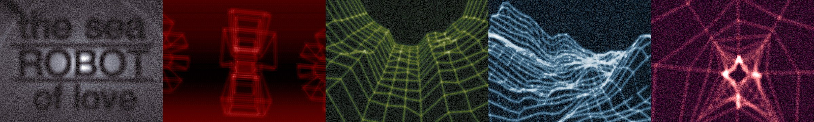
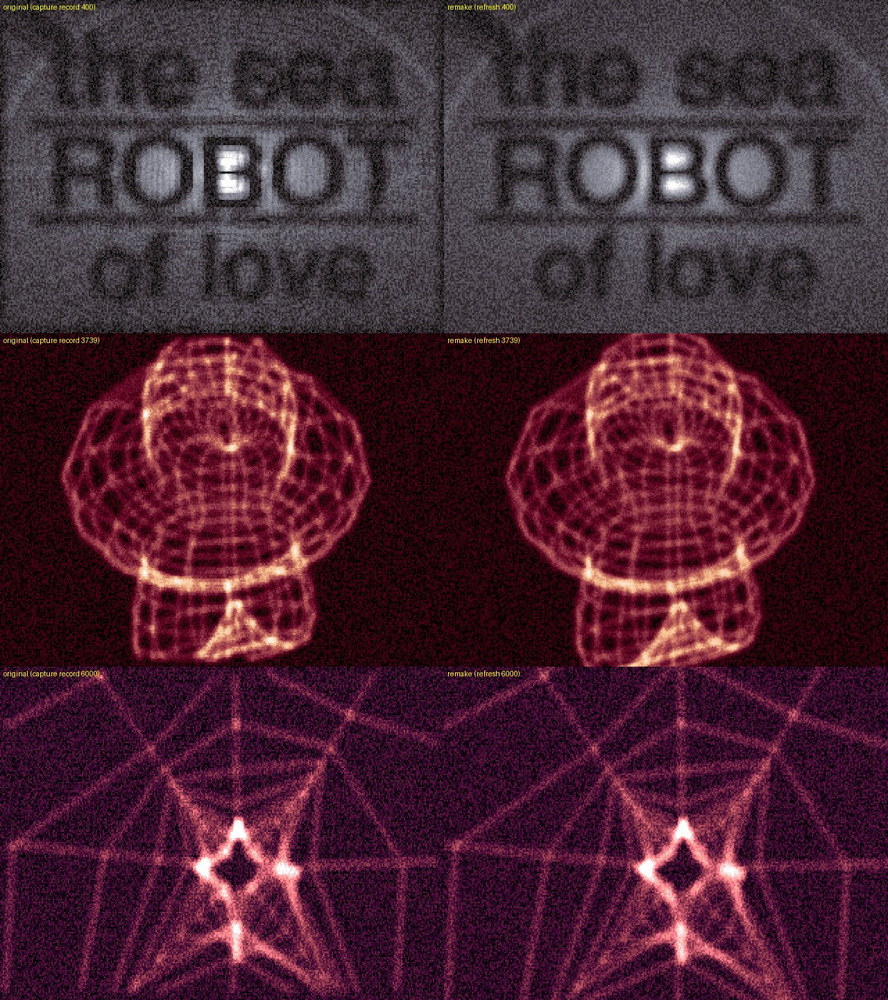

# The Sea Robot of Love by Orange

*The Sea Robot of Love* is a 64k intro by the Finnish group Orange that came 3rd in the PC intro competition at The
Party 1995 in Fredericia, Denmark (27–29 December 1995), with 521 points, behind Cubic Team and $een's *Lasse
Reinbong* and Yodel's *Illumination*. Its info file credits the programming to hoplite and dune, the sound effects
and music to dune, the font and graphics to der piipo, PMODE to Tran, the player to Phantom, and the 50 Hz mode to
liket. It needs a 386 and plays its music on a Gravis UltraSound. It is the third of Orange's robot intros, after
*Robot* (The Party 1994) and *Who Else Can Upgrade A Robot* (Abduction 1995).

The release on scene.org is called `okean.zip` and its program `KORSO2.EXE`. Neither name is explained anywhere we
looked: Orange's own index files its robot intros as `korso.zip`, `okean.zip` and `korso100.zip`, and dune's tune for
the first one is called "Korso". "Okean" is the word for ocean in Russian and several other Slavic languages, and
Korso is a district of Vantaa, north of Helsinki; no source says that either was meant.

`KORSO2.EXE` is 65,358 bytes: Tran's PMODE and one 32-bit assembly program packed with Rob Northen's ProPack, with the
8-channel music module inside it. It switches the VGA to its own 50 Hz version of mode 13h (`-M` keeps the usual
70 Hz) and draws everything as glowing wireframes in TV snow: soft lines built from small blobs of light added into
random noise and shown through palette ramps from black through one colour to white. The title "the sea ROBOT of
love" appears as shadows in a fan of light beams; then come red and green cogs that form a ribbed ball, a flying ring
and a tube; a green canyon flown over; a sphere that ripples and tumbles; a blue landscape with the captions "hmmm"
and "moving lightsource and shadow"; a magenta tunnel whose far end is a star; a curling sheet with "float robot
float" and "thy shall be upgraded"; and white texts and greetings on grey noise. It lasts 3 minutes 3 seconds.

Links: [pouet.net](https://www.pouet.net/prod.php?which=1303) · [demozoo](https://demozoo.org/productions/7690/) ·
[The Party 1995 results](https://files.scene.org/view/parties/1995/theparty95/results.txt) ·
[scene.org download](https://files.scene.org/view/demos/groups/orange/okean.zip)

## Watch

A 4K video of the remake is coming to YouTube.

## In this folder

| folder | what it is |
|---|---|
| [`remake/`](remake/) | The remake: every routine ported from the decompiled executable, checked against the original running in an emulator. [`remake/art/`](remake/art/) holds the redrawn pictures. |
| [`re/`](re/) | The reverse-engineering notes for every routine, the unpacker, the emulator harness and the scripts the agents used to check their models. |
| [`original/`](original/) | Put `KORSO2.EXE` here (it is not in the repository). |
| [`docs/making-of.md`](docs/making-of.md) | How the remake was made, and the decisions taken on the way. |
| [`docs/techniques.md`](docs/techniques.md) | What Orange achieved in 1995 and how. |

## Run it

Download the "The Sea Robot of Love remake" for Windows or Linux from [Releases](https://github.com/dvdstelt/demoscene/releases), unpack it and start `okean-remake`: the download includes the original release. Or build it yourself; the original release is in [`original/`](original/):

1. Build: `cmake -S okean/remake -B okean/remake/build -G Ninja && cmake --build okean/remake/build`. It needs SDL3,
   and CMake downloads it if it is missing.
2. Run: `okean/remake/build/okean-remake`. It starts fullscreen; add `--window` for a window.

The remake reads everything from the original file: it unpacks `KORSO2.EXE` as the packer's stub does, reads the
tables, palettes, meshes, maps, the font and the texts by address, and plays the module inside it with a port of the
intro's own player on a model of the GUS. Nothing from the intro is copied into the source.
[`remake/README.md`](remake/README.md) lists the options and the build details per platform.

## How close is it?

*The original (left, captured in the emulator) and the remake (right), at the same moments.*

The remake runs the original's routines, ported one by one from the decompiled executable and compared with a
capture of the original running in an emulator, one record per screen refresh. Python models of every part
reproduce the capture byte for byte, and the music player reproduces the original's sound-card register writes
exactly. The remake follows the original's clock, the 49.85 Hz refresh of its own screen mode, at any frame rate,
and starts every part in the refresh the original does. [`remake/README.md`](remake/README.md) lists the known
differences.
