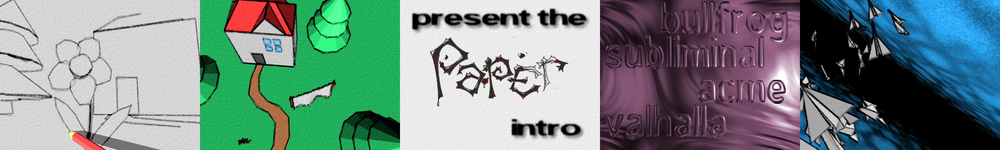
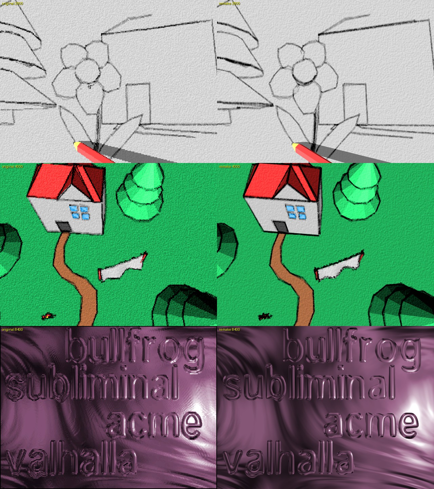

# Paper by Psychic Link

*Paper* is a 64k intro by Psychic Link, released at Wired '96 in November 1996. Code, graphics and design are by
Statix, and the music is by Vic of Acme. The whole production fits in one 63,845-byte DOS executable.

The intro opens on a sheet of paper. A red pencil sketches a flower and a house, the sketch turns into a coloured
3D scene, and the page peels away to a logo. Then come a paper plane over a teal canyon, greetings embossed in a
metallic surface, and a flock of 32 paper planes in a blue canyon.

That flock is missing from many videos of Paper online. On a fast PC the intro skips the part because of a race
in its palette fade. The remake always plays it, at the speed people remember it.

Links: [pouet.net](https://www.pouet.net/prod.php?which=75) · [demozoo](https://demozoo.org/productions/8041/) · [scene.org download](https://files.scene.org/view/parties/1996/wired96/in64/paper.zip)

## Watch

4K videos of the remake, and of the remake side by side with the original, are coming to YouTube.

## In this folder

| folder | what it is |
|---|---|
| [`remake/`](remake/) | The remake: every routine ported from the decompiled executable, checked tick by tick against the original running in an emulator. |
| [`re/`](re/) | The reverse-engineering notes for every routine, the emulator harness, the music player model and the scripts the agents used to check their models. |
| [`original/`](original/) | Put `PAPER.EXE` here (it is not in the repository). |
| [`docs/making-of.md`](docs/making-of.md) | How the remake was made. |

## Run it

1. Get the original: `scripts/fetch-originals.sh paper` from the repository root (Windows:
   `powershell -ExecutionPolicy Bypass -File scripts\fetch-originals.ps1 paper`), or copy `PAPER.EXE` into `paper/original/`.
2. Build: `cmake -S paper/remake -B paper/remake/build -G Ninja && cmake --build paper/remake/build`. It needs
   SDL3, and CMake downloads it if it is missing. On Windows, use the release zip instead.
3. Run: `paper/remake/build/paper-remake`. It starts fullscreen; add `--window` for a window.

The remake reads everything from `PAPER.EXE`: the program image (unpacked with its own PKLITE decoder), the tune and
samples, the font, the images, the 3D objects, the camera paths and the random seed. Nothing from the intro is
copied into the source. [`remake/README.md`](remake/README.md) lists what is read from where, all options and the
build details per platform.

## How close is it?

*The original (left, captured in the emulator) and the remake (right), at the same moments.*

The remake runs the original's logic at its own 70 Hz tick rate, with the same random numbers and the same
integer maths where it matters. It was compared with the original frame by frame over the whole run, and every
part lines up within one tick (14 ms). The music is the intro's own player, driving a model of the Gravis
UltraSound. It matches the reference player's output to within one step of 16-bit audio.

Known differences:

- **Flock positions.** The flock is the only part that moves once per drawn frame. The remake steps it at a fixed
  34 fps, while the capture varied between 33 and 37 fps, so late in the part the planes are up to about 8 steps
  away from the capture.
- **The greetings surface** is smoother than the original, whose fine streaks came from 8-bit texture sampling.
- **Pencil outlines** on the small flock planes are a little heavier than the original's.
