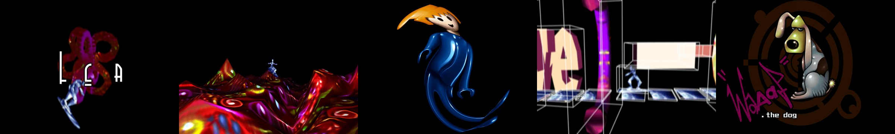
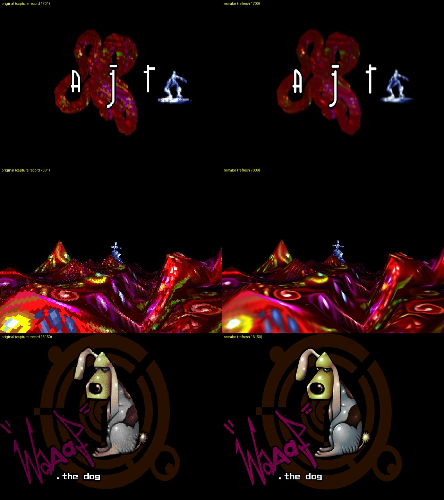

# Reve by Pulse

*Reve* ("dream" in French) is a PC demo by Pulse that came 5th in the PC demo competition at The Party 1995 in
Fredericia, Denmark (27–29 December 1995), with 339 points. Pulse had formed only weeks before, on 5 November 1995,
from the Polish members of Surprise! Productions and the French members of Distorsion and Infiny, and Reve was its
first production. The code is by LCA, the graphics by Antony and AJT, the music by Shad. Its NFO credits the 3D
objects to AJT, and Hornet's DemoNews names Antony as the artist of the still pictures. The final version of May 1996,
the one remade here, says it has "many bugs fixed and many new 3D scenes". It draws at 320×200 in 256 colours (VGA
mode 13h) and plays an 8-channel MOD by Shad on a Gravis UltraSound or a Sound Blaster.

`REVE.EXE` is exactly 999,999 bytes. It starts behind the Infiny Loader, 64 layers of self-decrypting code, which
unpacks LCA's own 32-bit DOS extender, FLAT OS V1.0. The rest of the file is an archive in LCA's own packer: the demo
program, the module, the pictures, palettes and blend tables, and six 3D worlds with their animations, 36 files in
all.

The demo runs on the screen refresh: its timer interrupt tunes itself to fire just before every vertical retrace,
and every movement is counted in refreshes. It opens with the title, REVE, in tall thin letters. The names of the
four members follow over a textured 3D knot that a surfer flies around, the whole frame softened by a blur. Then
come pictures that strobe between their colours and their negative, a cartoon alien over turning patterns, 3D worlds
the surfer rides through (blocks, a red landscape, objects in wireframe boxes, a spiked ring), a toy figure and a
mouth twisted into spirals, glowing dots on a spiral, planes of tiled cartoon pictures, and cartoon still pictures
between them. It ends on a boy with pink hair and the title again, after 4 minutes 13 seconds.

Links: [pouet.net](https://www.pouet.net/prod.php?which=70) · [demozoo](https://demozoo.org/productions/7641/) ·
[The Party 1995 results](https://demozoo.org/parties/94/) ·
[scene.org download](https://files.scene.org/view/demos/groups/pulse/pls_revf.zip)

## Watch

A 4K video of the remake is coming to YouTube.

## In this folder

| folder | what it is |
|---|---|
| [`remake/`](remake/) | The remake: every routine ported from the decompiled executable, checked against the original running in an emulator. [`remake/art/`](remake/art/) holds the redrawn pictures. |
| [`re/`](re/) | The reverse-engineering notes for every routine, the unpacker, the emulator harness and the scripts the agents used to check their models. |
| [`original/`](original/) | Put `REVE.EXE` here (it is not in the repository). |
| [`docs/making-of.md`](docs/making-of.md) | How the remake was made, and the decisions taken on the way. |
| [`docs/techniques.md`](docs/techniques.md) | What Pulse achieved in 1995 and how. |

## Run it

Download the "Reve remake" for Windows or Linux from [Releases](https://github.com/dvdstelt/demoscene/releases), unpack it and start `reve-remake`: the download includes the original release. Or build it yourself; the original release is in [`original/`](original/):

1. Build: `cmake -S reve/remake -B reve/remake/build -G Ninja && cmake --build reve/remake/build`. It needs SDL3,
   and CMake downloads it if it is missing.
2. Run: `reve/remake/build/reve-remake`. It starts fullscreen; add `--window` for a window.

The remake reads everything from `REVE.EXE`: it unpacks the archive as the extender does, relocates the demo
program, reads the pictures, palettes, tables, 3D worlds and the parts' parameters by name and address, and plays the
module with a port of LCA's MOD player on a model of the GUS. Nothing from the demo is copied into the source. The
hand-drawn pictures, the title and the names are shown as high-resolution redraws from `remake/art/`, and the 3D
textures get the detail of a 4× upscale; add `--original-art` to see the original pixels.
[`remake/README.md`](remake/README.md) lists the options and the build details per platform.

## How close is it?

*The original (left, captured in the emulator) and the remake (right), at the same moments.*

The remake runs the original's routines, ported one by one from the decompiled executable and compared with a
capture of the original running in an emulator, one frame per screen refresh. The music player reproduces the
original's sound-card register writes exactly. Reve counts its motion in screen refreshes, and the remake follows
that clock at any frame rate; each part starts on the refresh on which it starts in the capture.
[`remake/README.md`](remake/README.md) lists the remaining known differences.
