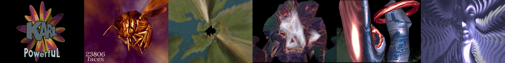
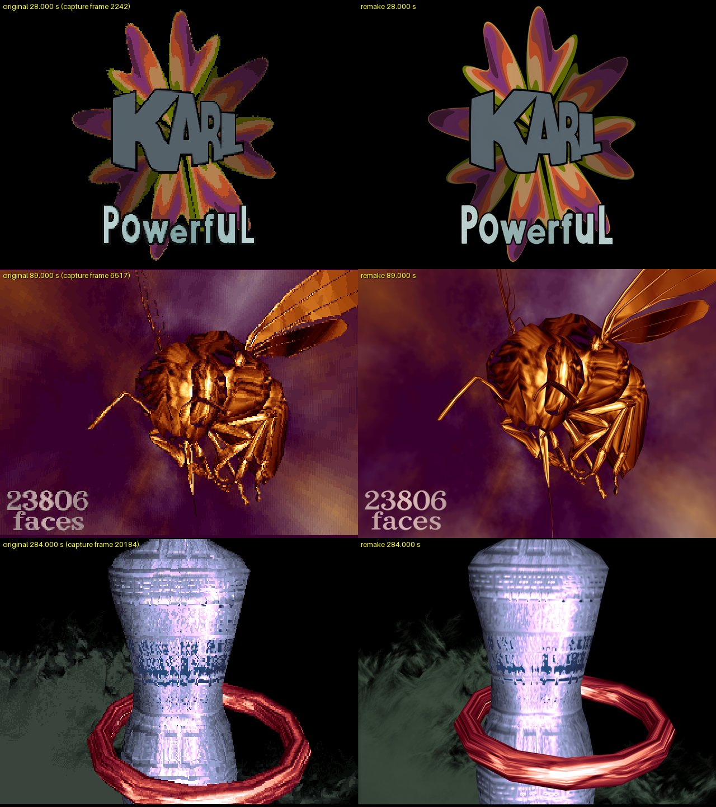

# STARS: Wonders of the World by NoooN

*STARS: Wonders of the World* is a demo by the French group NoooN that won the PC demo competition at Assembly '95
in Helsinki (August 1995). The NFO credits the "noise" to Groo, 3D motion and vertices to BARTi, system and special
effects to KARL, script and pixels to RA, and the "sound bugs" to LCA, whose MOD player plays the music; the
32-bit code runs under Tran's PMODE 3.07. According to the NFO it was a five-day production at KARL's place. It runs
in VGA mode 13h (320x200, 256 colours) and plays a 16-channel module on a Gravis UltraSound; the final release, the
one in this folder, also supports Sound Blaster cards and no sound, and is 400 KB smaller than the party version.

The demo opens with title cards: "join us", "Bring the family", the four authors' names over colour-cycling flowers
with a word each (BARTi "Atomic", KARL "Powerful", GROO "Magic", RA "Nutritive"), RA's pin-up women and a green
poodle, and the "STARS wonders of the World" title. Then a purple cloud tunnel; a golden bee of 23,806 faces
flying close to the camera; a ball of long spikes turning in front of a dark spiral; the three women warped over a
star shape; a voxel tunnel through green and blue earth; a stone wall that turns and bulges into faces in relief,
then changes to a texture of Celtic knots; a spiky ornament; a chrome star over a ring of small spiky shapes;
glowing blue particles with soft trails; a woman dissolving into a brown swirl; a stone torso with a red ring and a
pink mirror that reflects both; white particles that spell "NOOON", "BRING", "YOUR", "BEAUTY", "FAMILY"; a blue
sculpted face with trails flowing out of it; and the credits, ending on "NOOON 50 $". It lasts about 6 minutes 20
seconds.

Links: [pouet.net](https://www.pouet.net/prod.php?which=301) · [demozoo](https://demozoo.org/productions/648/) ·
[Assembly '95 results](https://demozoo.org/parties/103/#competition_705) ·
[scene.org download (final release)](https://files.scene.org/view/demos/groups/nooon/nooonstf.zip)

## Watch

A 4K video of the remake is coming to YouTube.

## In this folder

| folder | what it is |
|---|---|
| [`remake/`](remake/) | The remake: every routine ported from the decompiled executable, checked against the original running in an emulator, with high-resolution redraws of RA's pictures. |
| [`re/`](re/) | The reverse-engineering notes for every routine, the unpacker, the emulator harness and the scripts the agents used to check their models. |
| [`original/`](original/) | Put `STARS.EXE` here (it is not in the repository). |
| [`docs/making-of.md`](docs/making-of.md) | How the remake was made, and the decisions taken on the way. |

## Run it

1. Get the original: download [`nooonstf.zip`](https://files.scene.org/view/demos/groups/nooon/nooonstf.zip) from
   scene.org and unpack `STARS.EXE` into `stars/original/`.
2. Build: `cmake -S stars/remake -B stars/remake/build -G Ninja && cmake --build stars/remake/build`. It needs
   SDL3, and CMake downloads it if it is missing.
3. Run: `stars/remake/build/stars-remake`. It starts fullscreen; add `--window` for a window, and
   `--original-art` to see the original pixels instead of the redrawn pictures.

The remake reads everything from `STARS.EXE`: the program image (decrypted and decompressed as its loader does it),
the 58 data files of its overlay (pictures, palettes, maps, 3D objects, tables), the music module and the player's
tables, and the constants of every part. Nothing from the demo is copied into the source; the redrawn pictures in
[`remake/art/`](remake/art/) are made from the originals and say so. [`remake/README.md`](remake/README.md) lists the
options and the build details per platform.

## How close is it?

*The original (left, captured in the emulator) and the remake (right, with the redrawn pictures), at the same
moments.*

The remake runs the original's routines, ported one by one from the decompiled executable and compared with a
capture of the original running in an emulator at the speed of a 486DX2/66. The music player's sound-card writes
match the capture exactly, and the parts start at the music positions the original waits for. The random generator
is replayed from its seed, so the particles and their words appear where the original puts them.

Most of STARS moves with the timer interrupt, and the remake evaluates that motion continuously, so it is smooth at
any frame rate. A few effects advance once per drawn frame (the intro's colour cycling, the warp, the tunnel's
speed, the particles, the dissolving woman and the face); the remake steps them at the frame rate the capture shows
and blends between steps. The original shows each frame one or two retraces after it read the timer, so the
remake's motion runs 30–70 ms ahead of the capture.

The pictures are AI redraws of RA's pixel art at about 1450x1090, fitted onto the originals; the dissolving
woman still stamps the original pixels of the third pose (picture 13), whose redraw the intro and the warp show.
[`remake/README.md`](remake/README.md) lists the remaining known differences.
