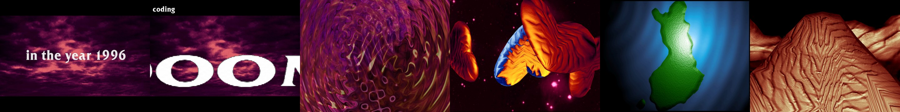
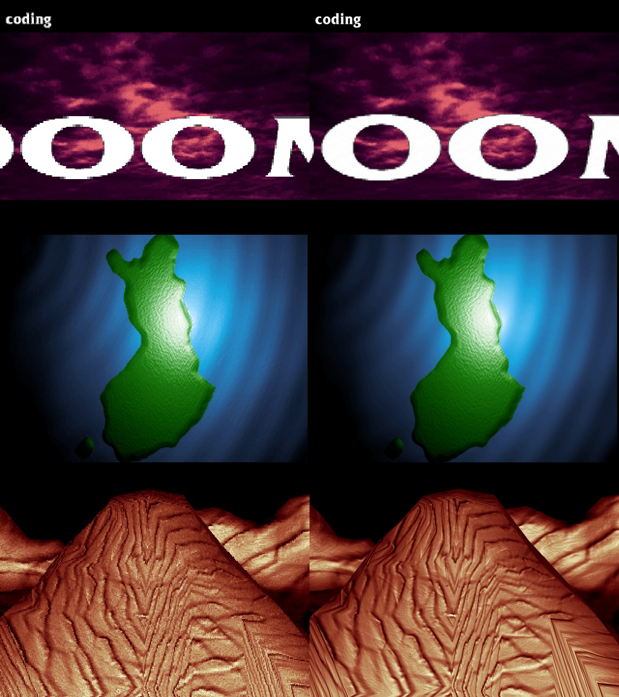

# Vivid Experiment by Doomsday

*Vivid Experiment* is a PC demo by the Finnish group Doomsday that placed 3rd in the PC demo competition at Assembly
1996 in Helsinki (16–18 August 1996), with 764 points, behind Dubius's *Machines of Madness* and Cubic Team's
*Toasted*. Its credits name Doom and MRI for the code, Dice and Damac for the graphics and Swallow and Wode for the
music; it plays its two halves to two modules, Wode's "Vivid" (`EXPRMNT1.XM`) and Swallow's "Experiment II"
(`EXPRMNT2.XM`), through the MIDAS Sound System by Sahara Surfers. It draws at 320×200 in 256 colours (VGA mode
13h). It was Doomsday's first demo; their next, *Boost*, which won Assembly '97, called itself its sequel.

`VIVID.EXE` is 1.8 MB: PMODE/W with the demo's Watcom C program in PMODE/W's own compressed format, and with all of
the demo's data, 159 files in three archives, linked into it. The running order is two text scripts that start
pictures, fades and effects at music positions.

Part I opens on a cloudy evening sky with the lines "in the year 1996", "a doomsday production" and "at assembly"
fading in and out. The credits' names fly out of the distance past the camera between letterbox bands, and the
title picture follows. Then come swirling, kaleidoscopic texture effects with photos of women over them, slides of
airbrushed pin-ups with captions written in line by line, a fiery 2 × 2 swirl and a painting of a winged man. Part
II starts with glossy hearts flying over a star cluster, then a bump-mapped map of Finland in rolling waves, two
blended texture tunnels, a flight over a bump-mapped landscape, an ice-like relief, tumbling blobs over a sunset, the
word "doomsday" bump-mapped in water and the greetings. It lasts 6 minutes 35 seconds.

The demo shows photos of women, two of them nude or nearly, and sexualised pin-ups (Demozoo tags it nsfw). The
remake shows them as the demo does; `--censor` covers their nude parts with a mosaic, and the video uses it.

Links: [pouet.net](https://www.pouet.net/prod.php?which=2167) · [demozoo](https://demozoo.org/productions/10152/) ·
[Assembly '96 results](https://ftp.scene.org/pub/parties/1996/assembly96/info/a96resul.txt) ·
[scene.org download](https://files.scene.org/view/parties/1996/assembly96/demo/vividexp.zip)

## Watch

A 4K video of the remake is coming to YouTube.

## In this folder

| folder | what it is |
|---|---|
| [`remake/`](remake/) | The remake: every routine ported from the decompiled executable, checked against the original running in an emulator. [`remake/art/`](remake/art/) holds the redrawn pictures. |
| [`re/`](re/) | The reverse-engineering notes for every routine, the unpacker, the emulator harness and the scripts the agents used to check their models. |
| [`original/`](original/) | Put `VIVID.EXE`, `EXPRMNT1.XM` and `EXPRMNT2.XM` here (they are not in the repository). |
| [`docs/making-of.md`](docs/making-of.md) | How the remake was made, and the decisions taken on the way. |
| [`docs/techniques.md`](docs/techniques.md) | What Doomsday achieved in 1996 and how. |

## Run it

Download the "Vivid Experiment remake" for Windows or Linux from
[Releases](https://github.com/dvdstelt/demoscene/releases), unpack it, run `fetch-originals.ps1` (Windows) or
`./fetch-originals.sh` (Linux) in its folder to get the original files, and start `vividexp-remake`. Or build it
yourself:

1. Get the original: `scripts/fetch-originals.sh vividexp` from the repository root (Windows:
   `powershell -ExecutionPolicy Bypass -File scripts\fetch-originals.ps1 vividexp`), or download
   [`vividexp.zip`](https://files.scene.org/view/parties/1996/assembly96/demo/vividexp.zip) from scene.org and put
   `VIVID.EXE`, `EXPRMNT1.XM` and `EXPRMNT2.XM` into `vividexp/original/`.
2. Build: `cmake -S vividexp/remake -B vividexp/remake/build -G Ninja && cmake --build vividexp/remake/build`. It
   needs SDL3, and CMake downloads it if it is missing.
3. Run: `vividexp/remake/build/vividexp-remake`. It starts fullscreen; add `--window` for a window.

The remake reads everything from the original files: it unpacks `VIVID.EXE` as PMODE/W does, reads the scripts,
pictures, palettes, tables, objects and splines from its archives by name and the rest by address, and plays the two
modules with a port of MIDAS's XM player on a model of the GUS. Nothing from the demo is copied into the source. The
opening's lettering, the credits' names and the winged man are shown as high-resolution redraws from
`remake/art/`; add `--original-art` to see the original pixels. The photos, the pin-ups and their captions are
always the original's. [`remake/README.md`](remake/README.md) lists the options and the build details per platform.

## How close is it?

*The original (left, captured in the emulator) and the remake (right), at the same moments.*

The remake runs the original's routines, ported one by one from the decompiled executable and compared with a
capture of the original running in an emulator, one frame per screen refresh. The music player reproduces the
original's sound-card register writes exactly, and every wait of the scripts ends on the refresh it ends on in the
capture.

Vivid Experiment counts everything in screen refreshes, and the remake follows that clock at any frame rate. It runs
every script command in no time, so the two 3D scenes, whose set-up took the original a few refreshes, start up to
14 refreshes earlier than in the capture. [`remake/README.md`](remake/README.md) lists the remaining known
differences.
